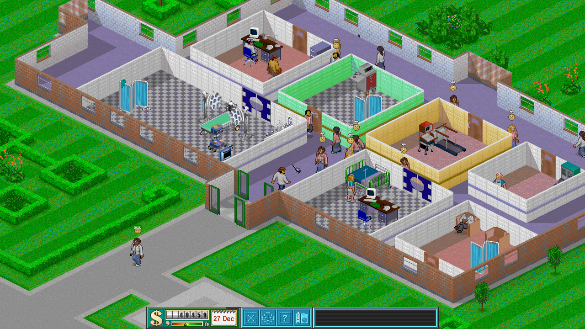
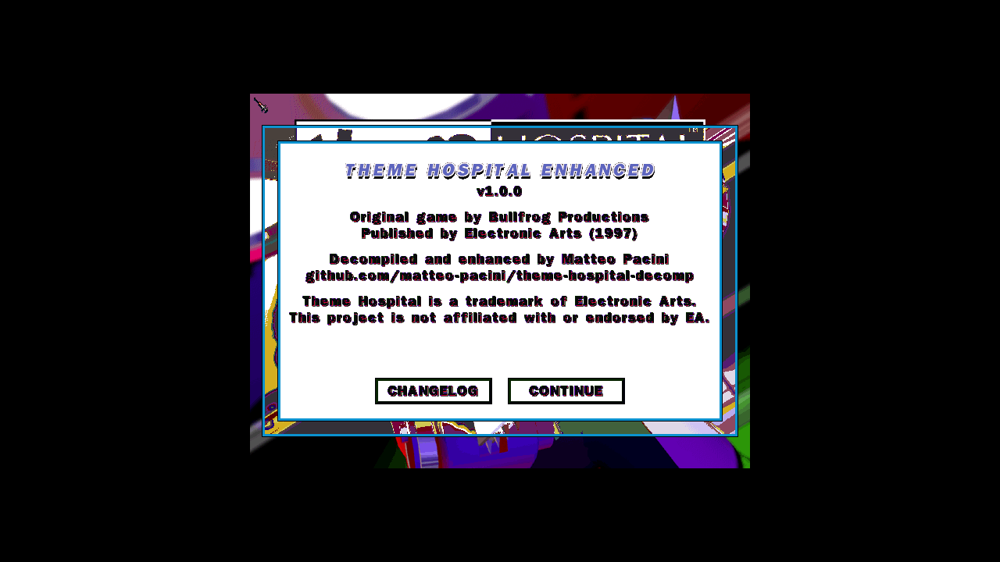
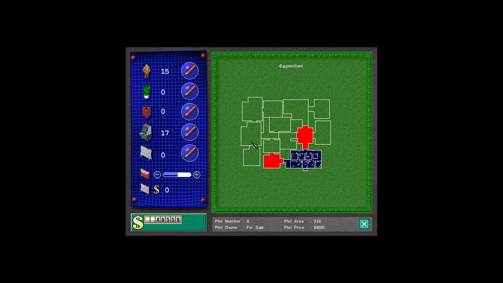
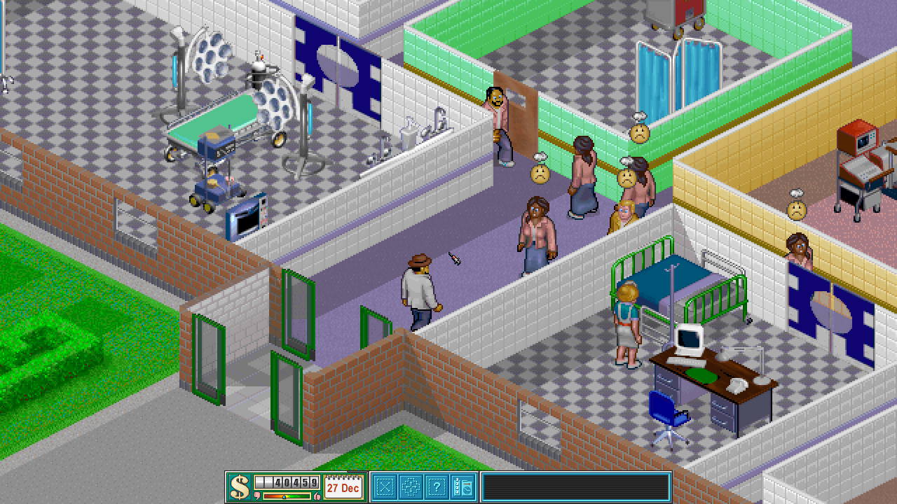

# Theme Hospital Enhanced

Theme Hospital, Bullfrog's 1997 hospital management game, rebuilt as a C++20
program that runs at any resolution and aspect ratio on Windows, macOS and
Linux, and in a browser. It is a port of a matching decompilation of the
original `HOSPITAL.EXE`, function by function, and plays like the original
turn by turn: every random draw happens in the original's order, and replays
of the same player actions through the original and through this port are
checked against each other.

Version 1.0.0 is the first release; see the
[changelog](enhanced/CHANGELOG.md). No game files are included: you need your
own copy of the game.

## What it does

- The whole single-player game: the 12 campaign levels and the two rat bonus
  levels, the win and lose letters, and the credits.
- Any resolution and aspect ratio, from the game's own data, with optional
  xBRZ upscaling of the graphics (2x to 6x).
- The original's rules, bugs included ([docs/BUGS.md](docs/BUGS.md) lists
  them), so that levels, rivals, emergencies and the year end go as they did.
- Sound effects, announcements and the music, with the jukebox.
- Saves in the original's slots, autosave on day 28, the cheats and the
  briefing's level pick.
- Six languages: English, French, German, Italian, Spanish and Swedish.
- PNG screen shots (Alt+C).
- A browser build that installs from the files you give it.

A close view with the original graphics, then the same view upscaled 4x with
xBRZ:

Screenshots show Theme Hospital's original art, © Electronic Arts, shown to
illustrate this project. No game files are included; you need your own copy.

## You need your own copy

The game data is read from your copy of Theme Hospital. The supported copy is
GOG's offline installer, from your GOG library (Theme Hospital → offline
backup installers):

| | |
| --- | --- |
| File | `setup_theme_hospital_v3_(28027).exe` |
| Size | 174,951,008 bytes |
| SHA-256 | `3475c2bb4b262156af4d92e6b1e9e20075f1788a8776835b534e2917c7921e93` |

On the first start the game finds no data and shows its setup screen. Choose
the GOG installer, or a folder with the game already installed from it, with
the buttons or by dropping it on the window. The installer's name, size and
SHA-256 are checked; the files are copied into the game's own folder, with a
progress bar and Cancel. The setup screen also offers to upscale the graphics
(xBRZ, 2x to 6x), done once at install. "Verify files" checks an install
again.

Where the files go:

| | Settings | Saves | Game data |
| --- | --- | --- | --- |
| Linux | `~/.config/ThemeHospitalEnhanced` | `~/.local/share/ThemeHospitalEnhanced/save` | `~/.local/share/ThemeHospitalEnhanced/game` |
| macOS | `~/Library/Application Support/ThemeHospitalEnhanced` | `…/save` | `…/game` |
| Windows | `%APPDATA%\ThemeHospitalEnhanced` | `%USERPROFILE%\Saved Games` | `%LOCALAPPDATA%\ThemeHospitalEnhanced\game` |

On Linux `$XDG_CONFIG_HOME` and `$XDG_DATA_HOME` are honoured. The options
(`--level N`, `--language N`, `--upscale`) and the folders are described in
the [developer guide](enhanced/README.md#game-data-and-the-users-folders).

## Run it

Natively, with [Nix](https://nixos.org/) and flakes enabled, from the
repository root:

    nix run path:./nix#enhanced
    nix run path:./nix#enhanced -- --level 5      # start at level 5 at once

To build it by hand with CMake instead, see
[Building](enhanced/README.md#building).

In the browser: <https://theme-hospital-enhanced.vercel.app/>. Pick your
installer or game folder on the page; the install runs in the page and no
game files are served.

## Building from source

CMake 3.24 or later and a C++20 compiler; SDL3 is used from the system if
found and fetched otherwise, and Dear ImGui is fetched. With Nix, the
`enhanced` dev shell has everything:

    nix develop path:./nix#enhanced
    cmake -S enhanced -B build/enhanced -G Ninja -DCMAKE_BUILD_TYPE=Release
    cmake --build build/enhanced
    build/enhanced/th_enhanced

The [developer guide](enhanced/README.md) covers the tests, the replay check
against the original, the debug reports, the browser build and its deploy.
[AGENTS.md](AGENTS.md) holds the working rules for coding agents.

## The decompilation

The port is built from a matching decompilation of the game: C++ that, compiled
with the original Watcom toolchain, reproduces `HOSPITAL.EXE` byte for byte.
That work, with its own README, its techniques
([docs/MATCHING.md](https://github.com/matteo-pacini/theme-hospital-enhanced/blob/decomp/docs/MATCHING.md))
and its tooling, lives on the
[`decomp`](https://github.com/matteo-pacini/theme-hospital-enhanced/tree/decomp)
branch. `src/` and `include/` here are its read-only reference for the replay
checks; fixes to them are made on `decomp` and merged into `master`.

## Credits and legal

Original game by Bullfrog Productions. Published by Electronic Arts (1997).
Decompiled and enhanced by Matteo Pacini,
[github.com/matteo-pacini/theme-hospital-enhanced](https://github.com/matteo-pacini/theme-hospital-enhanced).

Theme Hospital is a trademark of Electronic Arts. This project is not
affiliated with or endorsed by EA, Bullfrog Productions, RAD Game Tools or
Sybase; it is an unofficial, non-commercial fan project. The repository holds
no game files, apart from the screenshots above. Please don't open issues or
pull requests with game files or leaked material.

The engine, tools, build system and documentation are licensed under the GNU
General Public License, version 3 ([COPYING](COPYING)); the xBRZ scaler by
Zenju is its author's under GPL-3.0 only, so binaries that contain it are
conveyed under version 3. The reconstructed code in `src/` and `include/`,
including the Miles Sound System, Smacker and Watcom runtime code linked into
the game, is not ours to license; see [LICENSE](LICENSE). If you hold rights
to any of it and object, open an issue and it will be taken down.
